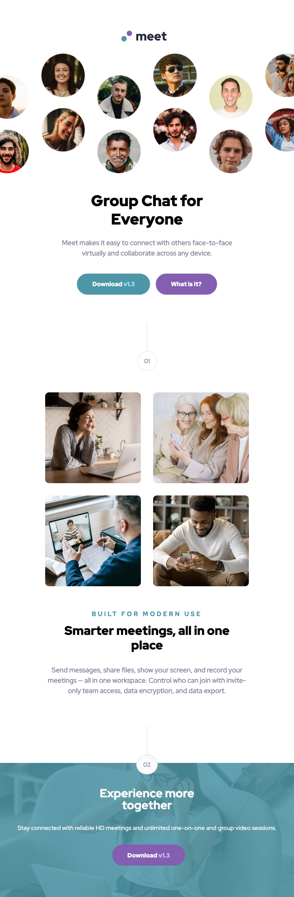
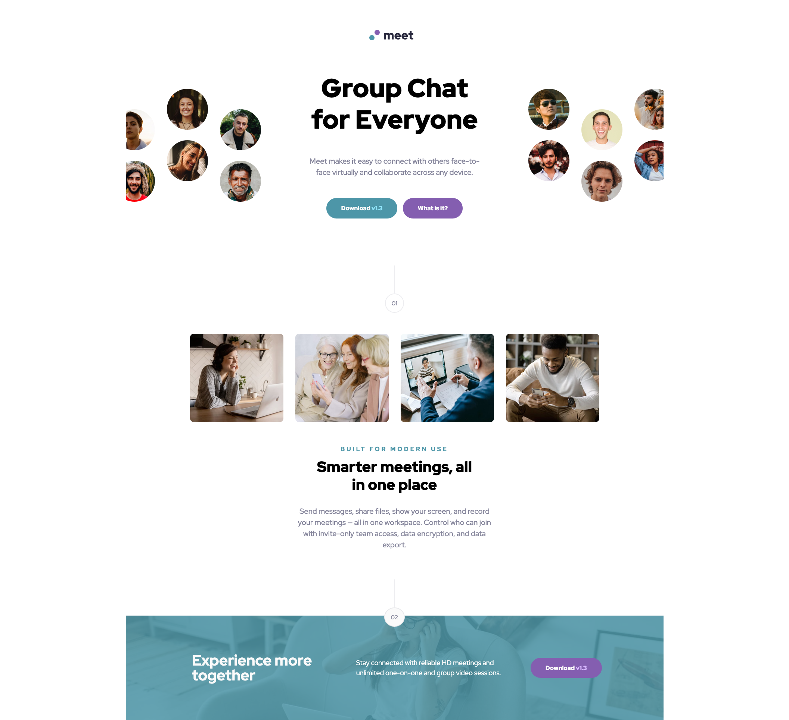

# Frontend Mentor - Meet landing page solution

This is a solution to the [Meet landing page challenge on Frontend Mentor](https://www.frontendmentor.io/challenges/meet-landing-page-rbTDS6OUR). Frontend Mentor challenges help you improve your coding skills by building realistic projects.

## Table of contents

- [Overview](#overview)
  - [The challenge](#the-challenge)
  - [Screenshot](#screenshot)
  - [Links](#links)
- [My process](#my-process)
  - [Built with](#built-with)
  - [What I learned](#what-i-learned)
  - [Continued development](#continued-development)
  - [Useful resources](#useful-resources)
  - [AI Collaboration](#ai-collaboration)
- [Author](#author)

## Overview

This project is a solution to the Frontend Mentor Meet landing page challenge. The goal was to build a responsive Meet landing page that matched the designs provided.

### The challenge

Users should be able to:

- View the optimal layout depending on their device's screen size
- See hover states for interactive elements

### Screenshot

### Links

- Github URL: https://github.com/arielvonlestat/Meet-Landing-Page

- Live Site URL: https://arielvonlestat.github.io/Meet-Landing-Page/

## My process

First i'd like to say that they challenge really rocked me out of my comfort zone. I really thought I understood responsive layout and then was immediately smacked in the face with it. Clearly this lesson is all about responsive layout and there's so much going on that it gets more and more complicated to keep track of.

I am not sure why I made the choice but I usually start off with a Mobile layout because it is easier. However, I decided to start with the Desktop layout first, proably becuase it was in my mind much harder. I figured I would get it out of the way and then it would make the rest of it easier. I think however, by doing this that I put myself at a disadvantage because right out of the gate I took my natural workflow and turned it on it's head.

I was not too far into making the Desktop layout before I decided that I needed to take a step away and learn a little bit mroe and come back to it. As listed below, I chose Josh Comeau's CSS Grid Interactive Website Lesson to go through heavily in it & take very detailed notes. It was really this that allowed me to come back and finish the Desktop layout.

Once I completed this I moved on to the Tablet Layout. I however, quickly found that I was having multiple media queries to fix basically everything. However, since my knowledge in responsive layout wasn't exactly what I thought it was, I painted myself into a pretty bad corner. What I mean by this is, I had query after query after query but it wasn't really fixing my issues as a whole and eventually it became so much that I started to lose track of where I was and somet things were getting overridden.

It was at this point that I almost started completely over with the project. Thinking very heavily that I had screwed up on not doing the Mobile layout first. However, the task was so daughting that I didn't want to really do that. I messed around with it for a while but ultimately thought that wasn't the way to go.

Instead, I chose to erase all of the media queries I had and carefully go through all of the issues step by step with ChatGPT. As I have mentioned before (and I mention below) I am very careful of how I use Chatp GPT (and honestly still was) but in this case I deicded to use it a little more heavily to understand and talk through deeper concepts. I realized I needed some step by step or one on one guidance on how to make things more responsive and why some things work and other don't.

This ultimately saved me and I wrote pages of notes with the information that I learned. I'm not sure I could sit down and do it all again from scratch but I am certainly better equipped to think of things in a more responsive manner and learning more and more and more how to achieve this.

### Built with

- Semantic HTML5 markup
- CSS custom properties
- Flexbox
- CSS Grid
- Desktop-first workflow
- VS Code

### What I learned

It's hard to even know where to begin with how much I learned in this project. By taking a step back I learned more about CSS Grid and feel way more proficent in using it. I took time to go over the fundamentals of Flex and finally really cemented how the directions and main and cross axis work together. This was a concept that I struggled with a lot when first learning it. This was not necessarily connected to the project but certainly helped me complete it.

By erasing my media queries and taking the time to go through my code and further responsive with ChatGPT I was able to take lots of notes on many different subjects.

These subjects included:

Using Clamp to make font size's more responsive. When to use them and when not to use them and the calculations for determing your vw and how that effects the overal layout. I learned that even though this can be use for all fonts it really isn't always necessary and will make extra work for you if you just do it all the time. I leared that sometimes it's better to just change the font size completely when you're making breakpoints instead of letting it shrink with Clamp.

I learned you can use transform to move items along a given axis for positioning when you are unable to do (or want to) otherwise.

I learned more responsive ways to use padding and when to use gap instead and that it (gap) can only be used with Flex. With this I learned two new properties that I did not know about "padding-inline" which you can use for left & right padding together and "padding-block" which you use for top & bottom together.

I could go on and on with how i've learned but these are the main take aways. However, the biggest take away I have from this challenge was not to just automatically fix everything with multiple media queries. This was what my first attempt was and in doing so I created an absolute mess of contradictions and hard to follow code. Again, it was so bad I had to delete it. I now understand that the better process is to see where the issues are occuring and attempt to make the original code more response to fix the issue and if that is not possible then and only then start looking at making a media query (or breakpoint). This above all changes my entire view on how to make responsive layouts.

### Continued development

As I have already stated, I was very humbled by this project. I wouldn't go so far as to say I was cocky but I certainly thought I knew more than I actually do. I would have said prior that I was ready to move on to Javascript but now I would say that isn't true. My main focus will be to continue my learning on continuing to understand how Responsive layout works and what works best for my and my workload. In addition to that, I want to explore Colt Steele's lessons on CSS Grid to further cement my knowledge with that.

### Useful resources

- [Udemy](https://www.udemy.com/course/html-and-css-bootcamp) - If nothing else this really helped me step away from the project that was overwhelming me and get a fresh perspective. I decided that I needed to stop and go over some fundementals when it came to responsive layouts & even flexbox (I will move on to grid next in this course). I actually learned a lot. Colt Steele's Web Developer Bootcamp is out I started (and what I will go back to when I begin to learn Javascript) but this course actually goes deeper into Flex & Grid. Highly recommended!

- [Josh Comeau](https://www.joshwcomeau.com/css/interactive-guide-to-grid/) - This interactive CSS Grid website was massively helpful to me. As someone who wasn't introduced to CSS Grid at all (for some reason it is not included on the above menionted Web Developer Bootcamp) this really helped me understand the basics of CSS Grid and take detailed notes that I hope will help me in the future. If you haven't checked it out yet I would also highly recommend it! He also has several other interactive lessons that I will be doing as well.

### AI Collaboration

- What tools did you use (e.g., ChatGPT, Claude, GitHub Copilot)?

I used ChatGPT.

- How did you use them (e.g., debugging, generating boilerplate, brainstorming solutions)?

I am always very careful in the way that I use it. I do not want it doing the work for me and therefore I only ask it specific questions to understand better. Typically overall concepts, or generalized ideas. I am careful not to ask it to just completely do something for me as I do not feel like I learn that way. If it does give me more information than I want (which it has from time to time) then I spend a lot of time understanding why the answer or concept works and if it doesn't explain it in a way I can understand I asked questions to make sure I understand it.

I essentially use it as a teacher.

That being said I used it a little more throughly that usual this go around. As stated above I painted myself into a corner I could not get out of with media queries and overall non-responsive original code. I had to go step by step through the process with ChatGPT to understand what I was doing wrong and how to improve it. I'd like to think I did a good job not relying completely on it just giving me answers but at the end of the day it was about surviving the challenge and learning as much as I could without losing my mind.

- What worked well? What didn't?

I'm honestly not sure that I would have been able to continue on with my pathway without it. I simply did not have the knowledge to change my code in a way that would have made it responsive enough. More than likely if I didn't have it as a teacher I would have had to start the project compeltely over and even then I am pretty convinced I would have made the same mistakes and really not understood how to fix them. With this step by step knowledge I've learned enough that the goal is to get further and further away from it's use.

## Author

- Frontend Mentor - [ArielVonLestat](https://www.frontendmentor.io/profile/arielvonlestat)
